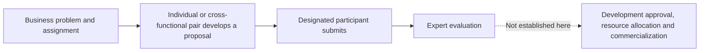

# P&G product workshop: what the evidence can locate

**Source-reading record, October 21, 2026. Not independently coded or replicated.**

The anchor is Dell'Acqua et al., *The Cybernetic Teammate: A Field Experiment on
Generative AI and Teamwork*, Organization Science 37(4), 1217-1242, online
June 12, 2026. [Publisher article](https://doi.org/10.1287/orsc.2025.20702),
[publisher PDF](https://pubsonline.informs.org/doi/pdf/10.1287/orsc.2025.20702).
The [records](../evidence.json) give claim IDs and printed-page locators.

## Bounded source facts

The authors report a one-day virtual workshop using company business problems.
P&G leaders described scheduling and functional frictions as motivation (C01).
Randomized conditions crossed individual versus R&D/commercial pairs with AI
access; AI conditions also received prompting training (C02, C04). One randomly
designated pair member shared the screen and submitted the solution (C03).
Expert ratings covered quality and technical/commercial orientation (C05).
The authors report more balanced outputs with AI (C06). This reading does not
establish the underlying interpersonal mechanism. Downstream development and
commercialization decisions were not directly observed; extended coordination
and rework were not fully captured by the one-day design (C07).

The journal reports 826 attendees, 791 randomized workshop completers and 776
with complete data including post-task surveys; 35 attendees were not randomized
(C08). The [2025 NBER version](https://www.nber.org/papers/w33641) foregrounded
776. These are version/denominator distinctions, not independent replications.

The published account includes company coauthors and disclosed company support.
It is an author-reported experiment, not an independent audit of P&G operations.
Preregistration is reported in the paper; direct registry access failed in this
reading, so its timing and original analysis specification were not separately checked.

## Process map and boundary

The arrows below describe protocol order, not a timestamped observation log.

| Link to inspect | Current evidence | What cannot be inferred |
|---|---|---|
| Task allocation and who is paired | C02 | How ordinary teams form or distribute work over months |
| Integration within a pair | C03, C05, C06 | Each person's contribution, negotiation or verification effort |
| Submission | C03 | Authority to approve investment, risk or launch |
| Evaluating a proposal | C05 | The firm's final commercial decision or realized value |
| Continuation beyond the workshop | C07 | A completed handoff into implementation or reduced total coordination burden |

## A practical gap, not a replacement claim

An output that includes two specialties' perspectives can arise through several
routes: a person learning, AI supplying a missing perspective, a teammate
integrating it, or additional checking by someone else. The reviewed outcome
cannot by itself identify which route occurred. This distinction remains useful
even when a treatment improves task performance.

For a later process observation, record the actual transition: what was ready,
what the next role needed, who could accept it, what remained unresolved and
whether work returned for revision. Keep proposal quality, coordination burden
and authority to commit resources separate. A process can improve one and
worsen another.

No cross-functional pair should be declared unnecessary from similar average
task scores. That is neither a formal equivalence conclusion nor a finding
about substituting for long-standing organizational relationships. The case
instead helps specify missing evidence for deciding where work should sit.

## Review still needed

Check the main-text locators against the published appendix and registration
history; reconcile assignment/attendance details before any causal reanalysis.
The appendix, raw data, code and original evaluation forms were not audited.
Ask whether the proposed handoff unit could be observed in a real workflow
without turning inferred dependencies into events. Independent source coding,
researcher understanding and methodological review remain pending.

Attribution: Organization Science, copyright 2026 The Author(s),
[DOI](https://doi.org/10.1287/orsc.2025.20702), used under
[Creative Commons Attribution 4.0](https://creativecommons.org/licenses/by/4.0/).
This note paraphrases selected facts and adds this project's questions; it does
not reproduce the paper, figures or data, or imply author endorsement.
